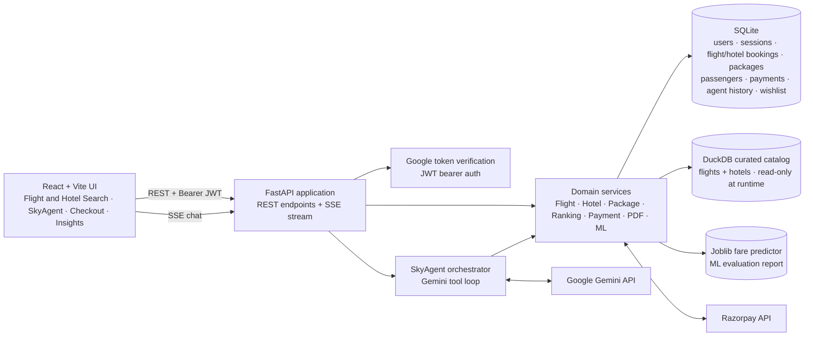

<div align="center">

# ✈️ FlightAgent India

**AI-powered flight and hotel search, booking, and travel analytics for India.**

Search flights and hotels manually or chat with **SkyAgent** to compare itineraries and book flights, hotels, or a complete flight + hotel package. Manage a Google-authenticated travel profile, co-travellers, wishlist, bookings, personal trip spending, and market fare insights in one dark-mode web app.

</div>

---

## Features

### Flight search and booking

- Search the flight catalog by Indian origin and destination, travel date, cabin class, passenger count, price, stops, and departure time.
- Review airline, flight code, schedule, duration, fare, and live seat availability.
- Rank and compare search results, including best-value and lowest-price options.
- Create a booking with passenger details and a short payment hold. Seat availability is checked again when the booking is created.
- Pay through Razorpay Checkout, verify payment, and retrieve a PNR and downloadable PDF e-ticket.
- Browse bookings by signed-in account or email, and retrieve a booking/ticket using its PNR.

### Hotel search and booking

- Search curated hotel inventory in Delhi, Mumbai, Bangalore, Kolkata, Hyderabad, and Chennai.
- The Home hotel search opens a dedicated `/hotels` results page. Filters and sorting are URL-backed; the responsive filter panel supports nightly budget, star rating, guest rating, locality, and number of nights.
- Compare value score and badge, ratings and reviews, landmark distance, base price, and source-provided tax or estimated GST.
- Start a standalone hotel checkout from a result card. A confirmed reservation provides a Hotel Booking Confirmation Voucher PDF.
- Select hotel and flight recommendations in SkyAgent to prepare a complete package. The package uses one user-confirmed Razorpay order and returns both a flight e-ticket PDF and a hotel voucher PDF.
- View flight, hotel, and package reservations in separate tabs on My Bookings.

### SkyAgent concierge

- Chat in natural language to search, filter, rank, and book flights through a Gemini function-calling loop.
- Stream assistant responses and tool activity to the browser using Server-Sent Events (SSE).
- Set a session budget in the chat or budget bar. The session cap is checked before booking and payment-order actions.
- Start or reopen agent sessions; conversation messages, tool steps, and session budget are persisted in SQLite.
- Signed-in users get profile-aware greetings and context, including saved traveller details and wishlist routes. Guest search and booking remain available.
- SkyAgent can search and rank hotels alongside flights, explain hotel tax estimates, and recommend combined itineraries. Checkout remains an explicit user action.

### Google account and travel profile

- Passwordless Google sign-in. The backend verifies the Google ID token and issues a stateless JWT used by authenticated API calls.
- Edit profile and contact fields, while the verified Google email remains locked.
- Track profile completion and manage saved co-travellers.
- Use profile and co-traveller information to help fill passenger and contact details at checkout.

### Wishlist, bookings, and trip analytics

- Save flight snapshots to a personal wishlist and return to booking from a saved flight.
- View My Bookings separately from **Trips Analysis**.
- Analyze confirmed trips or all non-cancelled bookings, including spend, trip counts, cities, routes, airlines, cabin classes, average ticket fare, and highest/lowest fare.
- View a spending timeline by month, or per-trip when the history is within one month.

### Fare and market insights

- `/market-insights` shows market-wide flight fare trends by route and cabin, airline price and fare-per-hour comparisons, departure-slot prices, and hotel prices and ratings across six cities. This dashboard is separate from personal Trips Analysis.
- A trained fare model estimates fair fare and near-term change, then shows an advisory **Book Now** or **Wait** signal with confidence and explanation on flight cards and in the dashboard.
- `scripts/train_and_evaluate_ml.py` trains and compares a route/cabin median baseline, Ridge regression, and a HistGradientBoostingRegressor. It writes `data/curated/fare_predictor.joblib` and `data/curated/ml_evaluation_report.json`.
- The evaluation report compares flight hybrid ranking with price-only ranking, and hotel value ranking with price-only and rating-only baselines using NDCG@5 and Precision@5. The current hotel hybrid score is below the price-only baseline in the evaluated queries; the dashboard reports the measured results.
- The dashboard also displays the ETL data-quality summary produced by `scripts/etl_and_validate.py`.

---

## Architecture



### Data and request flow

- **Frontend:** React 18, Vite, React Router, Tailwind CSS, Recharts, React Markdown, and Google OAuth components. Pages include Home search, flight `/results`, hotel `/hotels`, SkyAgent, profile, wishlist, My Bookings, personal `/trip-analysis`, and market `/market-insights`. `AuthContext` stores the JWT and profile in local storage, hydrates the profile on reload, and provides authenticated API requests.
- **API:** `backend/main.py` creates the FastAPI app, initializes SQLite on startup, configures CORS for local development, and registers the routers.
- **Transactional storage:** `data/app.db` stores users, profile data, co-travellers, wishlist items, flight and hotel bookings, package references, passengers, payment state, and agent session history. Startup migrations add missing columns without dropping existing tables. A package links its flight and hotel reservation with a shared `package_ref`.
- **Curated catalog:** `data/flights.duckdb` contains flights and the hotel table. Runtime services query it read-only. `scripts/etl_and_validate.py` cleans hotel CSVs and writes the unified data-quality report.
- **Fare model:** `backend/services/ml_service.py` lazily loads the joblib model, predicts fare timing, and falls back to route fare history if the artifact is unavailable. The market insights endpoint combines DuckDB trends with ML evaluation and ETL reports.
- **Agent:** The SSE endpoint passes optional authenticated profile context to the orchestrator. Gemini tools call the same flight, hotel, ranking, fare prediction, budget, booking, and payment services used elsewhere in the app.
- **Payments and documents:** Razorpay signature verification is shared by flight, hotel, and package payment verification. Package verification confirms both reservations in one SQLite transaction. ReportLab generates flight e-tickets and hotel vouchers.

---

## Project layout

```text
.
├── backend/
│   ├── agent/
│   │   ├── budget_guard.py       # Session budget checks
│   │   ├── orchestrator.py       # Gemini conversation and SSE stream
│   │   └── tools.py              # Gemini tool declarations and executor
│   ├── db/
│   │   ├── duck.py               # Read-only flight catalog connection
│   │   └── sqlite.py             # SQLite connection and safe migrations
│   ├── routers/
│   │   ├── agent.py              # Agent sessions, budget, and chat
│   │   ├── analytics.py          # Personal trip analytics
│   │   ├── auth.py               # Google sign-in and JWT session
│   │   ├── bookings.py           # Booking history and PDF ticket
│   │   ├── flights.py            # Flight search and lookup
│   │   ├── hotels.py             # Hotel inventory and data-quality summary
│   │   ├── hotel_bookings.py     # Standalone hotel reservations and vouchers
│   │   ├── insights.py           # Fare prediction and market trends
│   │   ├── payments.py           # Payment order and verification
│   │   ├── packages.py           # Combined flight + hotel checkout
│   │   ├── profile.py            # Profile and co-traveller APIs
│   │   └── wishlist.py           # Saved flights
│   ├── services/                 # Flight, hotel, package, ML, payment, and PDF logic
│   ├── config.py                 # Environment and data paths
│   ├── main.py                   # FastAPI application entry point
│   └── requirements.txt
├── frontend/
│   ├── src/
│   │   ├── api/                  # Backend API client
│   │   ├── components/           # Navbar and shared UI
│   │   ├── context/              # Authentication context
│   │   └── pages/                # Flight/hotel results, agent, checkout, profile, and insights
│   ├── .env.example
│   └── package.json
├── data/
│   ├── curated/                  # ETL/ML reports and trained fare predictor
│   └── raw/                      # Source flight and hotel data
├── scripts/                      # Catalog ETL, validation, and ML training/evaluation
├── .env.example
└── readme.md
```

---

## Run locally

### Prerequisites

- Python 3.11 or newer
- Node.js 18 or newer and npm
- A flight catalog at `data/flights.duckdb` (or the source CSV required by `scripts/load_flights.py`)
- Google OAuth client ID for sign-in
- Gemini API key for SkyAgent
- Razorpay test credentials for live checkout integration

### 1. Configure environment

Copy `.env.example` to `.env` and set the credentials you plan to use:

```env
GEMINI_API_KEY=your_gemini_api_key
GEMINI_MODEL=gemini-2.5-flash
RAZORPAY_KEY_ID=rzp_test_your_key_id
RAZORPAY_KEY_SECRET=your_razorpay_test_secret
GOOGLE_CLIENT_ID=your_client_id.apps.googleusercontent.com
JWT_SECRET=use-a-long-random-secret
```

Copy `frontend/.env.example` to `frontend/.env`:

```env
VITE_GOOGLE_CLIENT_ID=your_client_id.apps.googleusercontent.com
VITE_API_BASE=http://localhost:8000
```

Add `http://localhost:5173` to the authorized JavaScript origins for the Google OAuth web client. The backend has a development fallback for `JWT_SECRET`; configure a strong private value outside local development.

### 2. Prepare the flight catalog

The backend expects `data/flights.duckdb`. If you have the source dataset at `data/airlines_flights_data.csv`, build the catalog from the repository root:

```powershell
python scripts/load_flights.py
```

To curate hotel inventory and generate the unified data-quality report, place the six city CSVs in `data/raw/hotels/` and run:

```powershell
python scripts/etl_and_validate.py
```

To train the fare predictor and regenerate its evaluation report, run:

```powershell
python scripts/train_and_evaluate_ml.py
```

The API starts without the model artifact; fare advice then falls back to route fare history.

### 3. Install backend dependencies and start the API

From the repository root:

```powershell
python -m pip install -r backend/requirements.txt
python -m uvicorn backend.main:app --reload --port 8000
```

The interactive API documentation is at `http://localhost:8000/docs`.

### 4. Install frontend dependencies and start Vite

In another terminal:

```powershell
cd frontend
npm install
npm run dev
```

Open `http://localhost:5173`.

---

## Main API endpoints

| Area | Endpoint | Purpose |
| --- | --- | --- |
| Flights | `GET /api/flights/meta` | Search filter options |
| Flights | `POST /api/flights/search` | Search and rank flight inventory |
| Flights | `GET /api/flights/{flight_id}` | Fetch a flight for a travel date |
| Hotels | `GET /api/hotels/search` | Search and rank curated hotel inventory |
| Hotels | `GET /api/hotels/{hotel_id}` | Fetch a hotel listing |
| Hotels | `POST /api/hotel-bookings` | Create a standalone hotel checkout order |
| Hotels | `POST /api/hotel-bookings/{booking_ref}/verify-payment` | Verify hotel payment and confirm reservation |
| Hotels | `GET /api/hotel-bookings/{booking_ref}/voucher` | Download hotel confirmation voucher PDF |
| Packages | `POST /api/packages/book` | Create linked flight + hotel reservations and one payment order |
| Packages | `POST /api/packages/{package_ref}/verify-payment` | Confirm both reservations and return both document links |
| Packages | `GET /api/packages/{package_ref}` | Fetch combined package details and status |
| Insights | `POST /api/insights/predict-fare` | Get Book Now / Wait fare advice |
| Insights | `GET /api/insights/market-trends` | Get route, airline, departure, hotel, and model insights |
| SkyAgent | `POST /api/agent/session` | Create a chat session |
| SkyAgent | `PATCH /api/agent/session/{session_id}/budget` | Set or clear a session budget cap |
| SkyAgent | `POST /api/agent/message` | Send a message and receive SSE events |
| SkyAgent | `GET /api/agent/session/{session_id}/steps` | Restore session, messages, and tool activity |
| Auth | `POST /api/auth/google` | Verify Google credential and return a JWT |
| Auth | `GET /api/auth/me` | Fetch current user and profile completion |
| Auth | `POST /api/auth/logout` | Confirm stateless logout |
| Profile | `GET /api/profile`, `PUT /api/profile` | Read or update profile and contact details |
| Co-travellers | `/api/profile/co-travellers` | List, add, update, or delete saved travellers |
| Wishlist | `GET /api/wishlist`, `POST /api/wishlist`, `DELETE /api/wishlist/{flight_id}` | Manage saved flight snapshots |
| Bookings | `GET /api/bookings`, `POST /api/bookings` | List or create bookings; supports signed-in user linkage |
| Bookings | `GET /api/bookings/{pnr}`, `GET /api/bookings/{pnr}/ticket.pdf` | Retrieve booking or PDF e-ticket |
| Payments | `POST /api/payments/order`, `POST /api/payments/verify` | Create and verify a payment |
| Analytics | `GET /api/analytics/my-trips?scope=confirmed` | Authenticated personal travel and spend analytics (`scope=all` includes non-cancelled bookings) |
| Data quality | `GET /api/data-quality/summary` | Read the ETL data-quality report |

Profile, co-traveller, wishlist, and analytics endpoints require a valid bearer token. Booking and agent flows support guests where available.

---

## Payment testing

Use Razorpay **Test Mode** credentials only while developing. Complete checkout using the test payment options provided by Razorpay; do not enter real payment details. A successful verification confirms the booking and makes its ticket available by PNR.

---

## License

See [LICENSE](LICENSE) for license details.
