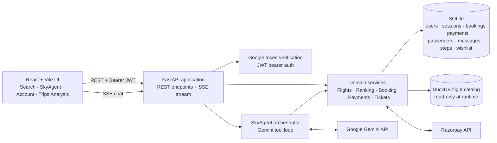

<div align="center">

# ✈️ FlightAgent India

**AI-powered flight discovery, booking, and personal travel analytics for India.**

Search flights manually or chat with **SkyAgent** to find, compare, and book options. Manage a Google-authenticated travel profile, co-travellers, wishlist, bookings, and trip spending in one dark-mode web app.

</div>

---

## Features

### Flight search and booking

- Search the flight catalog by Indian origin and destination, travel date, cabin class, passenger count, price, stops, and departure time.
- Review airline, flight code, schedule, duration, fare, and live seat availability.
- Rank and compare search results, including best-value and lowest-price options.
- Create a booking with passenger details and a short payment hold. Seat availability is checked again when the booking is created.
- Pay through Razorpay Checkout, verify payment, and retrieve a PNR and downloadable PDF e-ticket.
- Browse bookings by signed-in account or email, and retrieve a booking/ticket using its PNR.

### SkyAgent concierge

- Chat in natural language to search, filter, rank, and book flights through a Gemini function-calling loop.
- Stream assistant responses and tool activity to the browser using Server-Sent Events (SSE).
- Set a session budget in the chat or budget bar. The session cap is checked before booking and payment-order actions.
- Start or reopen agent sessions; conversation messages, tool steps, and session budget are persisted in SQLite.
- Signed-in users get profile-aware greetings and context, including saved traveller details and wishlist routes. Guest search and booking remain available.

### Google account and travel profile

- Passwordless Google sign-in. The backend verifies the Google ID token and issues a stateless JWT used by authenticated API calls.
- Edit profile and contact fields, while the verified Google email remains locked.
- Track profile completion and manage saved co-travellers.
- Use profile and co-traveller information to help fill passenger and contact details at checkout.

### Wishlist, bookings, and trip analytics

- Save flight snapshots to a personal wishlist and return to booking from a saved flight.
- View My Bookings separately from **Trips Analysis**.
- Analyze confirmed trips or all non-cancelled bookings, including spend, trip counts, cities, routes, airlines, cabin classes, average ticket fare, and highest/lowest fare.
- View a spending timeline by month, or per-trip when the history is within one month.

---

## Architecture



### Data and request flow

- **Frontend:** React 18, Vite, React Router, Tailwind CSS, Recharts, React Markdown, and Google OAuth components. `AuthContext` stores the JWT and profile in local storage, hydrates the profile on reload, and provides authenticated API requests.
- **API:** `backend/main.py` creates the FastAPI app, initializes SQLite on startup, configures CORS for local development, and registers the routers.
- **Transactional storage:** `data/app.db` stores users, profile data, co-travellers, wishlist items, bookings, passengers, payments, and agent session history. Startup migrations add missing profile columns without dropping existing tables.
- **Flight catalog:** `data/flights.duckdb` is queried read-only by the flight service and analytics endpoint. SQLite booking records are combined with catalog metadata for routes, airlines, and cabin class.
- **Agent:** The SSE endpoint passes optional authenticated profile context to the orchestrator. Gemini tool calls use the same flight, ranking, booking, payment, and budget services as the rest of the application.
- **Payments:** Razorpay order creation and signature verification update the booking/payment lifecycle. The ticket service generates PDF e-tickets for bookings.

---

## Project layout

```text
.
├── backend/
│   ├── agent/
│   │   ├── budget_guard.py       # Session budget checks
│   │   ├── orchestrator.py       # Gemini conversation and SSE stream
│   │   └── tools.py              # Gemini tool declarations and executor
│   ├── db/
│   │   ├── duck.py               # Read-only flight catalog connection
│   │   └── sqlite.py             # SQLite connection and safe migrations
│   ├── routers/
│   │   ├── agent.py              # Agent sessions, budget, and chat
│   │   ├── analytics.py          # Personal trip analytics
│   │   ├── auth.py               # Google sign-in and JWT session
│   │   ├── bookings.py           # Booking history and PDF ticket
│   │   ├── flights.py            # Flight search and lookup
│   │   ├── payments.py           # Payment order and verification
│   │   ├── profile.py            # Profile and co-traveller APIs
│   │   └── wishlist.py           # Saved flights
│   ├── services/                 # Flight, ranking, booking, payment, auth, ticket logic
│   ├── config.py                 # Environment and data paths
│   ├── main.py                   # FastAPI application entry point
│   └── requirements.txt
├── frontend/
│   ├── src/
│   │   ├── api/                  # Backend API client
│   │   ├── components/           # Navbar and shared UI
│   │   ├── context/              # Authentication context
│   │   └── pages/                # Search, agent, profile, bookings, wishlist, analytics
│   ├── .env.example
│   └── package.json
├── data/                         # Local database files and source flight data
├── scripts/                      # Flight catalog loader and verification utilities
├── .env.example
└── readme.md
```

---

## Run locally

### Prerequisites

- Python 3.11 or newer
- Node.js 18 or newer and npm
- A flight catalog at `data/flights.duckdb` (or the source CSV required by `scripts/load_flights.py`)
- Google OAuth client ID for sign-in
- Gemini API key for SkyAgent
- Razorpay test credentials for live checkout integration

### 1. Configure environment

Copy `.env.example` to `.env` and set the credentials you plan to use:

```env
GEMINI_API_KEY=your_gemini_api_key
GEMINI_MODEL=gemini-2.5-flash
RAZORPAY_KEY_ID=rzp_test_your_key_id
RAZORPAY_KEY_SECRET=your_razorpay_test_secret
GOOGLE_CLIENT_ID=your_client_id.apps.googleusercontent.com
JWT_SECRET=use-a-long-random-secret
```

Copy `frontend/.env.example` to `frontend/.env`:

```env
VITE_GOOGLE_CLIENT_ID=your_client_id.apps.googleusercontent.com
VITE_API_BASE=http://localhost:8000
```

Add `http://localhost:5173` to the authorized JavaScript origins for the Google OAuth web client. The backend has a development fallback for `JWT_SECRET`; configure a strong private value outside local development.

### 2. Prepare the flight catalog

The backend expects `data/flights.duckdb`. If you have the source dataset at `data/airlines_flights_data.csv`, build the catalog from the repository root:

```powershell
python scripts/load_flights.py
```

### 3. Install backend dependencies and start the API

From the repository root:

```powershell
python -m pip install -r backend/requirements.txt
python -m uvicorn backend.main:app --reload --port 8000
```

The interactive API documentation is at `http://localhost:8000/docs`.

### 4. Install frontend dependencies and start Vite

In another terminal:

```powershell
cd frontend
npm install
npm run dev
```

Open `http://localhost:5173`.

---

## Main API endpoints

| Area | Endpoint | Purpose |
| --- | --- | --- |
| Flights | `GET /api/flights/meta` | Search filter options |
| Flights | `POST /api/flights/search` | Search and rank flight inventory |
| Flights | `GET /api/flights/{flight_id}` | Fetch a flight for a travel date |
| SkyAgent | `POST /api/agent/session` | Create a chat session |
| SkyAgent | `PATCH /api/agent/session/{session_id}/budget` | Set or clear a session budget cap |
| SkyAgent | `POST /api/agent/message` | Send a message and receive SSE events |
| SkyAgent | `GET /api/agent/session/{session_id}/steps` | Restore session, messages, and tool activity |
| Auth | `POST /api/auth/google` | Verify Google credential and return a JWT |
| Auth | `GET /api/auth/me` | Fetch current user and profile completion |
| Auth | `POST /api/auth/logout` | Confirm stateless logout |
| Profile | `GET /api/profile`, `PUT /api/profile` | Read or update profile and contact details |
| Co-travellers | `/api/profile/co-travellers` | List, add, update, or delete saved travellers |
| Wishlist | `GET /api/wishlist`, `POST /api/wishlist`, `DELETE /api/wishlist/{flight_id}` | Manage saved flight snapshots |
| Bookings | `GET /api/bookings`, `POST /api/bookings` | List or create bookings; supports signed-in user linkage |
| Bookings | `GET /api/bookings/{pnr}`, `GET /api/bookings/{pnr}/ticket.pdf` | Retrieve booking or PDF e-ticket |
| Payments | `POST /api/payments/order`, `POST /api/payments/verify` | Create and verify a payment |
| Analytics | `GET /api/analytics/my-trips?scope=confirmed` | Authenticated personal travel and spend analytics (`scope=all` includes non-cancelled bookings) |

Profile, co-traveller, wishlist, and analytics endpoints require a valid bearer token. Booking and agent flows support guests where available.

---

## Payment testing

Use Razorpay **Test Mode** credentials only while developing. Complete checkout using the test payment options provided by Razorpay; do not enter real payment details. A successful verification confirms the booking and makes its ticket available by PNR.

---

## License

See [LICENSE](LICENSE) for license details.
